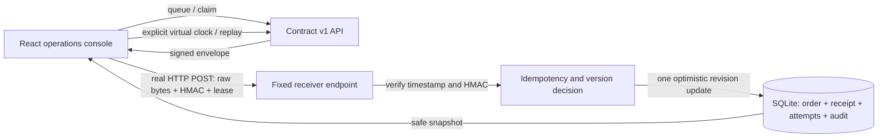

# Architecture, decisions and operator runbook

## Customer problem

An order platform receives repeated events, events that arrive out of order and notifications during downstream outages. An operator needs to distinguish rejected authentication from a retryable receiver failure, determine whether an effect already committed, and recover without losing the evidence.

## Architecture

There are two implementations: ASP.NET Core 10 with local SQLite, and the public Cloudflare Worker with D1. Both use the same SQL migration and HTTP acceptance scenarios. The browser never receives the session's signing key. It receives a single reserved envelope from the synthetic sender endpoint and posts it to a fixed receiver path.

The schema stores each bounded sandbox as one JSON state record with a revision. A mutation loads that revision, computes a new state and performs `UPDATE ... WHERE revision = ?`. A losing concurrent writer reloads and recomputes, up to eight attempts. A receipt, order effect, attempt result and audit transition therefore commit together. Repeated delivery of the same reserved attempt returns its cached response. A distinct job with the same event ID and identical raw bytes returns the original idempotency response. Conflicting bytes receive 409 and enter dead letters.

Events with a newer order version update the order. Older or equal versions receive 200 `ignored-stale`, preserving the current order. An idempotency conflict is separate from an order version check. Versioning is deliberately simple and specific to these synthetic order records.

## Decision record 001: SQLite and bounded snapshots

SQLite substitutes for SQL Server to make the .NET API reproducible without another server. D1 hosts SQLite for the public Worker. A single snapshot update provides a visible atomic commit boundary and avoids an undocumented multi-statement transaction assumption in D1. This trades query flexibility and large-queue efficiency for small, inspectable sessions. It is unsuitable as a large production event store. A production design would use normalized receipts and an inbox/outbox transaction, partitioning and retention appropriate to the load.

## Decision record 002: Public runtime

The selected public hosting platform runs JavaScript Workers, so it cannot run the ASP.NET process. The public Worker implements the same contract, while the runnable .NET API remains first-class source and CI coverage. The interface displays the real backend. The same HTTP suite prevents one implementation from being treated as an untested illustration.

## Decision record 003: Explicit time and fixed destination

Retry deadlines use a virtual clock so a visitor can inspect a complete outage/recovery in minutes. There is no background scheduler. A browser action performs every real HTTP delivery. Fixed retry delays are deterministic for reproducible evidence; jitter is intentionally omitted. The only destination is this application's receiver, avoiding arbitrary forwarding and user-provided credentials in the public demo. Production integrations would need background workers, jitter, per-destination policies, scoped keys, rotation, resource isolation and service monitoring.

## Authentication and data boundary

A new sandbox gets a random 256-bit capability scoped to a random sandbox ID. Only its SHA-256 hash is stored for capability lookup. The browser keeps the capability in session storage and sends it in an Authorization header. There is no sign-in. State views, evidence exports, test reports and audit entries exclude capabilities and signing keys. Treat a capability as a bearer secret; possession grants access to that synthetic sandbox.

HMAC-SHA256 covers the UTF-8 bytes of `timestamp + "." + rawBody`. Verification uses the platform cryptography provider: Web Crypto verify or .NET FixedTimeEquals. The five-minute past/future signature window uses the explicit lab clock. Capability expiry uses real UTC time. Content type, UTF-8, shape and size are checked. An unknown field is rejected. No customer endpoint or real webhook credential is accepted.

Bounds: 24 deliveries per sandbox; four attempts per cycle; three replay cycles; 200 audit entries; 512 KiB saved state; 8 KiB request; 24-hour capability lifetime; 200 live sandboxes globally. Expired rows are removed when a new sandbox is created. Failed CAS updates do not commit partial effects. The public cap is enforced by the same atomic INSERT that creates the row. This cap limits stored work; it is not a per-IP abuse-prevention service or an availability guarantee.

## Failure diagnosis

| Signal | Interpretation | Operator action |
| --- | --- | --- |
| 401 invalid-signature | Raw bytes/signature mismatch | Inspect the selected synthetic sender fault; replay with repair |
| 401 expired-timestamp | Timestamp outside the lab clock window | Repair sender timestamp before replay |
| 400 invalid-payload | Verified body is invalid | Repair synthetic payload before replay |
| 409 idempotency-conflict | An event ID has different bytes | Use a new event ID for changed data; do not overwrite the receipt |
| 503 receiver-unavailable | Injected outage | Restore Healthy; send when due or replay the dead letter |
| 503 response-lost-after-commit | Injected missing success after commit | Retry; verify cached response and one effect |
| 429 receiver-throttled | Injected receiver limit | Retry-After 8s takes precedence over the first 5s policy |
| 408 sender-timeout | Claimed envelope was not completed in 30 virtual seconds | Advance to retry deadline and send again |
| 410 session-expired | Real capability lifetime elapsed | Open a new sandbox |
| 429 sandbox-full / lab-capacity | A configured demo bound was reached | Reset your sandbox or retry after expired sessions are reclaimed |
| 409 concurrent-update | Eight optimistic retries did not settle | Refresh, inspect persisted state, retry the action |

The HTTP responses include an outcome and correlation ID. The audit tab and exported JSON are structured diagnostic records. Attempts retain status, virtual time, response body, retry deadline, cycle and side-effect flags. Application error logs contain error types only. Capabilities, signatures and request bodies are not logged. Audit retention is bounded and is not a compliance archive.

## Recovery walkthrough

Run the outage scenario, select Healthy, replay and send. Four 503 attempts and the successful replay remain in the inspector. Queue the identical event and send it; the duplicate count increases and the order-effect count stays unchanged. A dead-letter replay creates a new attempt cycle without deleting old evidence. Repair only removes the selected synthetic sender fault, not the event payload or event ID.

## Build, deploy and rollback

`npm run build` compiles React and embeds its local assets, documentation and JSON validation reports into `dist/server/index.js`. No client CDN is required. `.openai/hosting.json` selects the existing Sites project and D1 binding. Sites applies Drizzle SQL migrations, then deploys the built Worker. The Worker sets CSP, no-frame, nosniff and no-referrer headers; API responses are no-store.

Push reviewed source, run the checks in README, package that exact commit, save a Site version and deploy it. DNS for `integration.bestdev.co.il` must use the hosting service's issued records. Check real HTTPS, origin checks, static assets, the HTTP acceptance suite and an operator recovery in the browser after publication. Roll back by redeploying a previously validated Site version. Preserve forward-compatible migrations; do not edit an applied migration. Session data persists across Worker versions through the D1 binding. Reset affects only the current sandbox. Public validation creates and removes only its own synthetic sessions.
